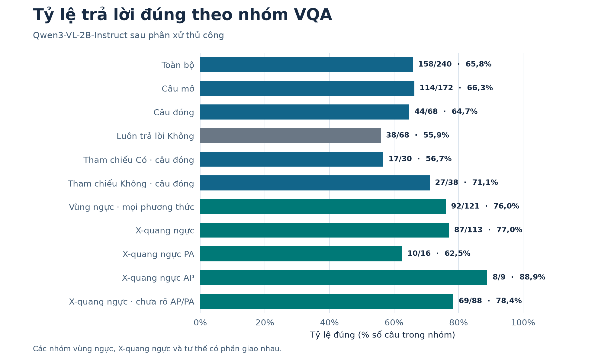
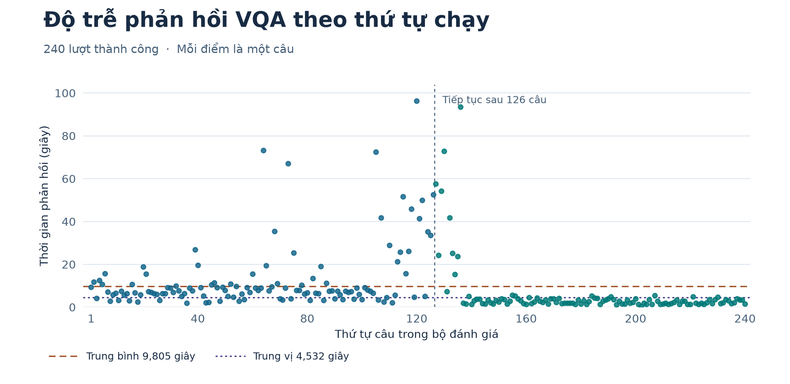

# Báo cáo thực nghiệm VQA và Captioning

**Ngày 24/11/2026.** Qwen3-VL-2B-Instruct trả lời đúng **158/240 câu VQA (65,8%)** trên **150 ảnh** sau phân xử thủ công. Có **82 câu sai, 0 lỗi thực thi và 0 ca chưa phân xử**. Trong lượt Captioning mở rộng, mô hình trả mô tả cho **35/35 ảnh**. Có **9/35 mô tả bao phủ đủ ý chính** và **23/35 mô tả chứa ít nhất một chi tiết mâu thuẫn với căn cứ**. Trong 9 mô tả đủ ý chính, **6 mô tả** vẫn có chi tiết mâu thuẫn. [Phiếu chấm Captioning](../../results/captioning_expanded_41e1c65_real_rubric.csv)

Ngày 25/11/2026, Phúc duyệt hoàn thiện phần đánh giá cục bộ. Phần bổ sung gồm chấm độ rõ tiếng Việt cho đầu ra VQA đã lưu, đồng bộ dữ liệu mặc định VQA và kiểm tra lại tổng hợp Captioning bằng CLI.

## Bộ đánh giá VQA

Bộ cuối giữ nguyên nội dung và ID của 109 câu đã xác minh. Trong 131 câu bổ sung, có 105 câu X-quang ngực và 26 câu về các vùng hoặc dạng câu khác. Năm câu được phục hồi từ nhóm bàn giao sau khi đối chiếu lại ảnh và căn cứ, giữ ID cũ. ViMed cung cấp 126 câu mới có ID riêng, gồm 91 câu từ split `test` và 35 câu từ `validation`. Trong 126 câu ViMed, 99 câu truy về split `train` của SLAKE gốc và 27 câu đến từ VQA-RAD. Cột split trong CSV phân biệt split ViMed với split nguồn gốc khi truy được. [Danh sách 240 câu](../data/evaluation/questions.csv) · [Quyết định cho các câu bàn giao](../../results/vqa_240_dataset/handover_disposition.csv)

Trước suy luận, nhóm rà 20 ứng viên để hiệu chỉnh cách tuyển. Việc kiểm tra gồm mở ảnh, đối chiếu câu–đáp tiếng Việt và tiếng Anh với annotation, rà ảnh trùng qua nguồn và nội dung kể cả khi ảnh được đổi kích thước hoặc mã hóa lại, rồi loại câu trùng ý trên cùng ảnh. Ưu tiên phủ ảnh trước. Câu thứ hai trên một ảnh được giữ khi kiểm tra một khả năng khác. Đáp án Có/Không được gán `closed`, các câu còn lại dùng `open`. Sau khi kiểm tra cả 150 ảnh bằng `prepare_image` của pipeline, danh sách và hàm băm được lưu lúc **21:38:17 (UTC+7)**, trước khi bắt đầu chạy Qwen. [Rà 20 ứng viên](../../results/vqa_240_calibration_first20.csv) · [Biên bản đóng bộ](../../results/vqa_240_dataset/freeze.json) · [SHA-256 của CSV và ảnh](../../results/vqa_240_dataset/SHA256SUMS.txt)

Bộ có 172 câu mở và 68 câu đóng, với 30 nhãn `Có` và 38 nhãn `Không`. Trong 121 câu vùng ngực, 113 câu thuộc phim X-quang ngực, gồm 16 câu PA, 9 câu AP và 88 câu chiếu thẳng chưa xác định AP/PA. Các nhóm ngực, X-quang ngực và PA lồng nhau. Một ảnh có thể có cả câu mở và câu đóng. Ảnh `vqa240_i080.jpg` xuất hiện ở hai split ViMed qua hai câu khác ý. [Thống kê bộ đã đóng](../../results/vqa_240_dataset/statistics.csv) · [Phân bố đáp án](../../results/vqa_240_dataset/answer_distribution.csv)

## Thiết lập và cách chấm

Lượt chính thức dùng checkout cục bộ dựa trên commit `41e1c65b866c5ffcfeb21615bdf7ea5fffe6fb4c` cùng evaluator đã bổ sung checkpoint. Evaluator gọi trực tiếp `build_pipeline(use_mock=False)` và gửi ảnh cùng câu hỏi vào tác vụ `vqa`. Trọng số Qwen3-VL-2B-Instruct revision `89644892e4d85e24eaac8bacfd4f463576704203` được đọc từ cache cục bộ. Môi trường Windows dùng RTX 4050 Laptop GPU (6 GB VRAM), Python 3.11.9, PyTorch 2.8.0+cu128, CUDA 12.8, Transformers 4.57.6, Torchvision 0.23.0+cu128, Accelerate 1.16.0 và Hugging Face Hub 0.36.2. [Log lượt chính thức](../../results/vqa_240_41e1c65_real.log) · [Mã evaluator tại thời điểm chạy](../../results/provenance/evaluate_vqa_official_41e1c65.py)

Cấu hình dùng prompt `vqa.vi`, thiết bị và kiểu số tự chọn (CUDA và BF16 trên máy này, xác nhận trong lượt pilot), tối đa 128 token sinh thêm và cạnh dài ảnh tối đa 768 px. Model sinh với `do_sample=False`, `use_cache=True` và cấu hình không lượng tử hóa 4-bit. Giới hạn đầu vào là 15 MB mỗi ảnh và 1.500 ký tự mỗi câu hỏi. Captioning dùng `caption.vi` trong cả hai lượt. [Cấu hình model](../configs/model_config.yaml) · [Prompt](../configs/prompt_config.yaml) · [Mã sinh đầu ra](../src/models/pretrained_vlm.py) · [Log pilot](../../results/pilot_41e1c65_real.log)

Evaluator lưu nguyên văn `raw_answer`, kết quả `answer`, trạng thái, lỗi và thời gian theo từng `question_id`. Điểm câu đóng ban đầu dựa trên đối chiếu nhãn chuẩn hóa với tham chiếu. Câu mở được chấm theo nghĩa. Với 22 ca chưa phân xử, bước rà soát khóa diễn giải từ câu hỏi và toàn bộ `raw_answer` trước khi mở tham chiếu. Một lưu ý về chi tiết phụ vẫn có thể đi cùng câu trả lời đúng về ý chính. Câu chỉ nêu khả năng, từ chối hoặc rút lại câu trả lời chính được tính sai khi tham chiếu đủ rõ. Các lượt rà giữ nguyên đầu ra, nhãn chuẩn hóa và thời gian. [Đầu ra từng câu](../../results/vqa_240_41e1c65_real.csv) · [Phiếu phân xử theo ID](../../results/vqa_240_41e1c65_real_adjudicated_rubric.csv)

## Kết quả VQA

Từ cùng đầu ra đã lưu, **22 ca chưa phân xử** được chấm thành **10 đúng và 12 sai**. Tổng điểm chuyển từ **148/240 (61,7%)** lên **158/240 (65,8%)** do hoàn tất việc chấm. Cả 48 ca có cách diễn đạt tương tự được rà thêm đều giữ nguyên điểm. Sau phân xử, mẫu số đã chấm bằng mẫu số toàn bộ trong mỗi nhóm dưới đây. [Tổng hợp trước–sau](../../results/vqa_240_41e1c65_real_adjudicated_summary.csv)

| Nhóm | Số ảnh | Đúng / Tổng | Tỷ lệ đúng |
| --- | ---: | ---: | ---: |
| Toàn bộ | 150 | 158 / 240 | 65,8% |
| Câu mở | 123 | 114 / 172 | 66,3% |
| Câu đóng | 50 | 44 / 68 | 64,7% |
| Câu đóng, tham chiếu Có | 26 | 17 / 30 | 56,7% |
| Câu đóng, tham chiếu Không | 32 | 27 / 38 | 71,1% |
| Vùng ngực, mọi phương thức | 106 | 92 / 121 | 76,0% |
| X-quang ngực | 102 | 87 / 113 | 77,0% |
| X-quang ngực PA | 10 | 10 / 16 | 62,5% |
| X-quang ngực AP | 9 | 8 / 9 | 88,9% |
| X-quang ngực chiếu thẳng, chưa xác định AP/PA | 83 | 69 / 88 | 78,4% |
| 109 câu giữ nguyên | 27 | 58 / 109 | 53,2% |
| 131 câu bổ sung | 126 | 100 / 131 | 76,3% |
| 5 câu pilot trùng bộ chính | 3 | 3 / 5 | 60,0% |

Với 68 câu đóng, chiến lược luôn trả lời `Không` đạt **38/68 (55,9%)**. Qwen đạt **44/68 (64,7%)**, cao hơn **8,8 điểm phần trăm** trên cùng nhóm câu. [Tổng hợp câu đóng](../../results/vqa_240_41e1c65_real_adjudicated_summary.csv)



### Phân xử và căn cứ bám ảnh

| ID | Kết quả | Căn cứ phân xử |
| --- | --- | --- |
| `Q_0040` | Đúng | “Bức ảnh cho thấy tủy sống” xác nhận sự hiện diện. Câu dè dặt giới hạn ở các chi tiết của tủy sống. Trường `answer` chuẩn hóa lưu trống. |
| `Q_0090` | Sai | “Có thể là thực quản” chỉ nêu khả năng. Annotation qid 1449 cho nhãn Có, trong khi phần còn lại vẫn cho biết mô hình chưa xác định được. |
| `Q_0120` | Sai | “Đây là một hình ảnh CT đầu” phù hợp ở câu đầu. Câu cuối báo ảnh thiếu thông tin để trả lời chính câu hỏi về vùng đầu. |
| `Q_0126` | Sai | Mô hình nêu hai thùy thái dương và dè dặt về vị trí. Câu cuối từ chối trả lời toàn bộ câu hỏi, nên số đếm không được giữ như một kết luận nhất quán. |

Phiếu cuối ghi **16 ca có chi tiết mâu thuẫn với căn cứ** và **36 ca có chi tiết cần xác minh**. Đây là số ca có ghi nhận riêng trong phiếu. Chẳng hạn, `VM240_RAD_1153` trả lời đúng ý chính PA theo annotation nhưng phần nói thấy hộp sọ mâu thuẫn với trường ảnh. Với `Q_0153`, ý chính có dấu hiệu bất thường khớp nhãn tham chiếu. Vị trí cụ thể và khả năng viêm phổi vẫn thuộc diện cần xác minh. [Phiếu phân xử, cột `extra_claim_grounding` và `extra_claim_excerpt`](../../results/vqa_240_41e1c65_real_adjudicated_rubric.csv)

### Độ rõ tiếng Việt

Một trợ lý đọc toàn bộ `raw_answer` của 240 câu và gán mức theo độ dễ hiểu. Đợt hiệu chỉnh 10 ID gồm câu mở, câu đóng và ca từ chối. Trong 10 ca, `Q_0014` là lời từ chối rõ ràng và `Q_0081` bị hạ mức vì lặp kéo dài. Sau hiệu chỉnh, trợ lý áp dụng cùng tiêu chí cho toàn bộ 240 câu, chấm theo từng ID và ghi lý do cụ thể mỗi khi hạ mức. Số người chấm độc lập là **0**. Phiếu mở rộng bảo toàn các trường gốc và điểm nội dung **158/240**. [Phiếu 240 câu có độ rõ tiếng Việt](../../results/vqa_240_41e1c65_real_adjudicated_vietnamese_clarity.csv)

Các ID hiệu chỉnh gồm `Q_0001`, `Q_0014`, `Q_0081`, `Q_0100`, `Q_0165`, `Q_0166`, `Q_0180`, `VM240_SLAKE_2028`, `VM240_RAD_1153` và `VM240_SLAKE_600`.

| Mức | Tiêu chí | Số câu | Tỷ lệ trên 240 |
| --- | --- | ---: | ---: |
| Rõ | Hiểu ngay ý định của câu trả lời. Thuật ngữ và viết tắt chuyên môn được chấp nhận. | 212 | 88,3% |
| Cần biên tập | Hiểu được ý nhưng câu gượng, lặp hoặc trộn ngôn ngữ gây khó đọc. | 28 | 11,7% |
| Không đạt | Chủ yếu dùng ngôn ngữ khác hoặc diễn đạt đến mức khó xác định ý. | 0 | 0,0% |

`Q_0081` lặp “có thể là vùng não trung tâm” nhiều lần. `Q_0134` viết “một mặt cắt cắt ngang” dù câu trả lời đúng về nội dung. `VM240_SLAKE_648` có cụm “không khí không khí trong phổi”. `Q_0014` được chấm Rõ vì lời từ chối dễ hiểu, dù sai theo phiếu nội dung. [Đầu ra và ghi chú theo ID](../../results/vqa_240_41e1c65_real_adjudicated_vietnamese_clarity.csv)

### Độ trễ và khả năng tiếp tục

Trên 240 lượt thành công, thời gian phản hồi **trung bình 9,805 giây** và **trung vị 4,532 giây** mỗi câu. Phân vị 95 là 42,059 giây (nội suy tuyến tính) và lượt dài nhất là 96,303 giây. Evaluator dùng `time.perf_counter()` ngay trước và sau lời gọi `answer_question`. Khoảng đo gồm tiền xử lý ảnh, tạo prompt, chờ và thực thi suy luận, cùng thời gian pipeline trả đầu ra. Khởi tạo model, đọc CSV và lưu checkpoint nằm ngoài thời gian đo theo câu. [Độ trễ từng câu](../../results/vqa_240_41e1c65_real.csv) · [Mã đo thời gian](../src/evaluation/evaluate_vqa.py)

Trong lượt chạy, tiến trình được khởi động lại khi độ trễ tăng và tiếp tục từ **126 ID** đã lưu, giữ cùng cấu hình và bộ dữ liệu. Log ghi thời gian khởi tạo lần đầu **25,234 giây** và khi tiếp tục **20,961 giây**. Biểu đồ giữ thứ tự các ID trong CSV để thấy sự thay đổi độ trễ qua hai phiên. [Log chạy VQA](../../results/vqa_240_41e1c65_real.log) · Checkpoint SQLite lịch sử lưu trong gói bàn giao cục bộ.



## Captioning

### Rà ảnh và chốt tập mở rộng

Tập mở rộng có **35 ảnh**, gồm 20 CT, 13 X-quang và 2 MRI. Độ phủ theo nhóm vùng gồm đầu, khung chậu và cổ (mỗi nhóm 5 ảnh), ngực và bàn tay (mỗi nhóm 4), bụng và vùng chuyển tiếp bụng–đáy ngực (mỗi nhóm 3), cùng cổ chân–bàn chân, cẳng tay–bàn tay và cẳng chân (mỗi nhóm 2). Ba ảnh PA `PHOI_3`, `PHOI_4`, `PHOI_5` trùng pilot. Hai tệp `ERR_*` dành cho kiểm thử đầu vào nằm ngoài 35 ảnh có metadata. [Metadata bàn giao](../data/evaluation/metadata.csv) · [Danh sách tham chiếu mở rộng](../../results/captioning_expanded_41e1c65_references.csv)

Mỗi ảnh được mở và đối chiếu với metadata, ảnh hoặc annotation nguồn đã truy được trong audit, và ghi chú dựng lại bộ VQA. Tiêu chí chọn là xác minh được phương thức, vùng chụp và hai ý cấu trúc chính từ trường ảnh và nguồn. Sáu ảnh có thêm một đặc điểm nổi bật đủ căn cứ để chấm. Những chẩn đoán, nhận định bình thường và chi tiết chưa xác minh được ghi chú trong từng dòng. Cả 35 ảnh đạt tiêu chí ở mức mô tả trực tiếp và đọc được qua `prepare_image`. Tham chiếu được khóa lúc **23:23:26 (UTC+7), ngày 24/11/2026**, trước suy luận. [Audit bàn giao](../../results/vqa_audit_tri_branch_96ec26a.csv) · [Ghi chú dựng lại](../../results/vqa_rebuilt_96ec26a_all_status.csv) · [SHA-256 và biên bản đóng tham chiếu](../../results/captioning_expanded_41e1c65_freeze.json)

Với `PHOI_1`, ảnh nguồn `xmlab246/source.jpg` khớp ảnh bàn giao. Lát cắt có gan, lách và hai thận, phù hợp qid 1195 và dòng VQA `Q_0056` xác định vùng bụng. Tham chiếu Captioning sửa từ CT ngực sang CT bụng lát ngang. Tên tệp và metadata gốc được giữ để truy vết. [Ảnh `PHOI_1`](../data/evaluation/images/phoi_1.jpg) · [CSV tham chiếu Captioning](../../results/captioning_expanded_41e1c65_references.csv)

### Kết quả lượt mở rộng

Lượt mở rộng gọi trực tiếp `build_pipeline(use_mock=False)` rồi `pipeline.run(..., task="caption")` cho từng ảnh. Pipeline dùng cùng revision Qwen và cấu hình đã nghiệm thu, nạp trên RTX 4050 ở BF16. Cả **35/35 ảnh** có đầu ra, với **0 lỗi thực thi**. Thời gian đo bằng `time.perf_counter()` quanh lời gọi pipeline, gồm tiền xử lý, tạo prompt và sinh đầu ra. Khởi tạo model mất **16,360 giây** và được đo riêng. Độ trễ trung bình là **10,973 giây/ảnh**, trung vị **9,840 giây/ảnh**, dao động **5,463–24,833 giây**. [Đầu ra theo ảnh](../../results/captioning_expanded_41e1c65_real.csv) · [Log và cấu hình lượt mở rộng](../../results/captioning_expanded_41e1c65_real.log)

Mỗi mô tả được chấm theo phương thức, vùng chụp, hai ý cấu trúc và đặc điểm nổi bật nếu có trong tham chiếu. Mô tả bao phủ đủ khi đáp ứng tất cả các mục áp dụng, và bao phủ một phần khi đáp ứng ít nhất một mục nhưng còn thiếu ý. Chất lượng tiếng Việt và chi tiết ngoài ý chính được ghi riêng. Vì vậy một mô tả đủ ý chính vẫn có thể chứa chi tiết mâu thuẫn hoặc chưa đủ căn cứ. Điểm dựa trên đọc và đối chiếu ảnh, tham chiếu đã khóa và câu mô tả đầy đủ. [Tiêu chí chấm](Ghi-chu-cham-thu-Captioning-VQA.md) · [Phiếu chấm từng ảnh](../../results/captioning_expanded_41e1c65_real_rubric.csv)

| Phương thức | Số ảnh | Đúng phương thức | Đúng vùng | Bao phủ đủ | Bao phủ một phần |
| --- | ---: | ---: | ---: | ---: | ---: |
| CT | 20 | 19 | 17 | 6 | 14 |
| MRI | 2 | 2 | 2 | 0 | 2 |
| X-quang | 13 | 13 | 8 | 3 | 10 |
| **Toàn bộ** | **35** | **34** | **27** | **9** | **26** |

Model mô tả đúng đặc điểm nổi bật ở **2/6 ảnh** có mục này. Tiếng Việt rõ nghĩa ở **15/35 ảnh** và cần chỉnh ở **20/35 ảnh**, chủ yếu do lặp, câu dang dở hoặc cách gọi giải phẫu mơ hồ. Có **23/35 ảnh** với ít nhất một chi tiết mâu thuẫn với căn cứ và **27/35 ảnh** với ít nhất một chi tiết cần xác minh. Hai nhóm có thể giao nhau. Trong **32 ảnh ngoài pilot**, **6/32** mô tả bao phủ đủ, so với **3/3** ở ba ảnh trùng pilot được chấm theo tham chiếu mở rộng. [Tổng hợp theo phương thức, vùng và phần giao pilot](../../results/captioning_expanded_41e1c65_real_summary.csv)

- `PHOI_1` được nhận diện đúng là CT bụng với gan và hai thận, nhưng bỏ sót lách. Mô tả “chụp từ phía trước” lệch với lát ngang. Nhận định “có thể là khối u hoặc tổn thương bất thường” cần căn cứ độc lập.
- `KHUNG_CHAU_3` được nhận diện đúng phương thức CT, nhưng “hai lá phổi” và “xương sườn” mâu thuẫn với trường ảnh tiểu khung.
- `PHOI_5` bao phủ đủ ý chính về X-quang ngực, phổi và bóng tim. Chi tiết “xương đùi” mâu thuẫn với trường ảnh và được ghi riêng trong phiếu.

### Lượt pilot trên ba ảnh PA

Model chạy thật thành công trên ba phim X-quang ngực có metadata PA. Thời gian mỗi ảnh là thời gian thực bao quanh `pipeline.run(..., task="caption")` trong pilot, sau khi khởi tạo pipeline Captioning trong cùng tiến trình đã nạp model cho VQA. [Đầu ra và thời gian Captioning](../../results/captioning_pilot_41e1c65_real.csv) · [Metadata ảnh](../data/evaluation/metadata.csv) · [Phiếu chấm pilot](../../results/rubric_pilot_41e1c65_real.csv)

| Ảnh | Tóm tắt đầu ra | Thời gian | Đối chiếu theo phiếu |
| --- | --- | ---: | --- |
| [`PHOI_3`](../data/evaluation/images/phoi_3.jpg) | X-quang ngực chiếu thẳng, hai lá phổi, xương sườn và bóng tim. | 12,491 giây | Loại ảnh, phổi và bóng tim phù hợp metadata. Mô tả bỏ sót góc sườn–hoành được ghi trong metadata. |
| [`PHOI_4`](../data/evaluation/images/phoi_4.jpg) | X-quang ngực chiếu thẳng, phổi, xương sườn và dây dẫn. Nêu một vùng mờ ở phần dưới bên phải. | 13,757 giây | Dây và thiết bị thấy được trên phim. Bỏ sót xương đòn và bờ vòm hoành. Hai nhận định về vùng mờ tự mâu thuẫn và chưa rõ quy ước định bên, nên vị trí cần xác minh. |
| [`PHOI_5`](../data/evaluation/images/phoi_5.jpg) | X-quang ngực chiếu thẳng, phổi, xương sườn, bóng tim và chi tiết “xương đùi”. | 17,654 giây | Phổi và vùng trung thất phù hợp với ảnh và metadata. “Xương đùi” mâu thuẫn với trường ảnh. Cụm “các vấn đề như khí quản” gây khó hiểu. |

Lượt pilot VQA có sáu ca tính điểm và một ca thăm dò. Năm ID `Q_0058`, `Q_0008`, `Q_0110`, `Q_0206`, `Q_0171` nằm trong bộ chính và đạt 3/5 ở lượt chính thức. Hai câu do nhóm soạn nằm ngoài bộ 240. `PILOT_01` hỏi loại ảnh và câu trả lời tự mâu thuẫn. `PILOT_02` hỏi bệnh sử, có đầu ra “Không thể xác định từ hình ảnh này” và được chuẩn hóa thành `Không đủ thông tin`. [Đầu ra VQA pilot](../../results/vqa_pilot_41e1c65_real.csv) · [Phiếu rà soát thử](Ghi-chu-cham-thu-Captioning-VQA.md)

## Tái lập lượt đánh giá

### Dữ liệu mặc định và mã nguồn

Evaluator VQA mặc định dùng `Course_work/data/evaluation/questions.csv` và `Course_work/data/evaluation/vqa_images/`. CSV và 150 ảnh khớp mã băm trong biên bản khóa của lượt chính thức. Với CSV khác, `--image-dir` mặc định vẫn trỏ đến `data/evaluation/images/`. Bộ bàn giao 235 câu dành cho ứng dụng và trình demo được lưu riêng tại `data/evaluation/questions_handover_235.csv` và dùng chung thư mục ảnh với Captioning. [CSV mặc định VQA](../data/evaluation/questions.csv) · [CSV bàn giao 235 câu](../data/evaluation/questions_handover_235.csv) · [SHA-256 bộ VQA](../../results/vqa_240_dataset/SHA256SUMS.txt)

Nhánh đánh giá có sẵn mã, dữ liệu mặc định và kết quả đã chấm. Trong danh sách SHA-256 gốc, đối chiếu mục `questions.csv` với `data/evaluation/questions.csv`, và các mục `images/` với `data/evaluation/vqa_images/`. [Biên bản khóa Captioning](../../results/captioning_expanded_41e1c65_freeze.json)

### Tổng hợp từ phiếu Captioning

Từ `Course_work`, lệnh sau ghép theo `image_id`, lấy đánh giá nội dung từ phiếu và tính thống kê từ cột `time_s` của các lượt thành công đã lưu. Kết quả tái tạo đủ 16 dòng trong bảng chính thức, với **35/35 có đầu ra, 9/35 đủ ý, 23/35 có mâu thuẫn, 27/35 cần xác minh** và **10,973 giây/ảnh** trung bình. Lệnh đọc ba CSV, in bảng CSV ra màn hình hoặc ghi vào đường dẫn mới khi có `--output`, và chạy được bằng môi trường kiểm thử CPU. [Evaluator Captioning](../src/evaluation/evaluate_captioning.py) · [Bảng tổng hợp chính thức](../../results/captioning_expanded_41e1c65_real_summary.csv)

```powershell
python src/evaluation/evaluate_captioning.py --summarize-reviews `
  ../results/captioning_expanded_41e1c65_references.csv `
  ../results/captioning_expanded_41e1c65_real.csv `
  ../results/captioning_expanded_41e1c65_real_rubric.csv
```

### Suy luận và chấm một lượt mới

Kích hoạt môi trường Python/CUDA đã ghi ở phần thiết lập, xác nhận cache Qwen trỏ tới revision `89644892e4d85e24eaac8bacfd4f463576704203` và kiểm tra mã băm của đầu vào. Từ thư mục `Course_work`, dùng lệnh PowerShell tương đương lượt VQA chính thức, với tên tệp mới cho lần tái lập.

```powershell
Remove-Item Env:USE_MOCK -ErrorAction SilentlyContinue
$env:HF_HUB_OFFLINE = '1'
python src/evaluation/evaluate_vqa.py `
  --output ../results/vqa_240_reproduction.csv `
  --checkpoint ../results/vqa_240_reproduction.sqlite
```

Nếu lượt tái lập bị gián đoạn, chạy lại cùng lệnh với cùng đầu vào, cấu hình và checkpoint của lượt đó. CSV sinh ra ghi đầu ra và trạng thái tự động. Điểm cuối cần áp dụng quy tắc chấm theo nghĩa và quy trình phân xử đã mô tả. [Log lượt VQA chính thức](../../results/vqa_240_41e1c65_real.log) · [Phiếu phân xử](../../results/vqa_240_41e1c65_real_adjudicated_rubric.csv)

Để tái lập suy luận Captioning, nạp danh sách tham chiếu đã khóa theo thứ tự CSV, dùng `build_pipeline(use_mock=False)` một lần rồi gọi `pipeline.run(str(image_path), task="caption")` cho mỗi `filename`. Đo thời gian bằng `time.perf_counter()` quanh mỗi lời gọi và chấm đầu ra mới theo phiếu tham chiếu. Từ `Course_work`, dùng `python -X utf8 reproduce_captioning.py --output ../results/captioning_expanded_reproduction.csv` để chạy suy luận theo quy trình đó. CLI Captioning cũ với `metadata.csv` vẫn tính BLEU-1 và F1 token như số đo so khớp văn bản. [Danh sách tham chiếu](../../results/captioning_expanded_41e1c65_references.csv) · [Log Captioning](../../results/captioning_expanded_41e1c65_real.log)

## Giới hạn

Tỷ lệ đúng mô tả bộ câu hỏi đã tuyển và cấu hình chạy này. Các câu dùng lại ảnh nên kết quả theo câu có thể phụ thuộc lẫn nhau. Phân bố nghiêng về X-quang ngực do mục tiêu tuyển mẫu và nhóm PA chỉ có 16 câu trên 10 ảnh. Split của ViMed và SLAKE gốc khác nhau, có ảnh giao giữa hai split ViMed và có năm câu trùng pilot. Các nhóm này không tạo thành các phép đánh giá độc lập.

Điểm độ rõ tiếng Việt phản ánh cách áp dụng rubric của một trợ lý trên đầu ra đã lưu. Chưa có lượt chấm của người để kiểm tra độ nhất quán giữa người chấm.

Captioning phản ánh 35 ảnh có sẵn và một lượt chấm thủ công. Cỡ mẫu theo nhóm nhỏ và không đều, đặc biệt MRI chỉ có hai ảnh. Phần giao ba ảnh PA với pilot hạn chế so sánh độc lập giữa hai lượt. Căn cứ chấm tập trung vào cấu trúc và dấu hiệu nhìn thấy trên ảnh, với các nhận định lâm sàng thiếu xác minh được ghi riêng. Kết quả mô tả ảnh đơn trong bộ đồ án và có phạm vi suy rộng hạn chế.
